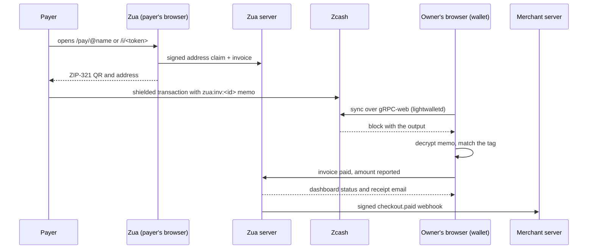

<p align="center">
  <picture>
    <source media="(prefers-color-scheme: dark)" srcset="web/public/assets/zua-white.svg" />
    
  </picture>
</p>

<h1 align="center">Zua</h1>

<p align="center">
  Shielded ZEC payments for freelancers, creators and small shops. Get paid with a username, a link, an invoice or a widget, and let the blockchain record that a payment happened, not who paid whom or how much.
</p>

<p align="center">
  <a href="https://zua-one.vercel.app"></a>
  <a href="https://github.com/maulana-tech/zua"></a>
  <a href="https://zips.z.cash"></a>
  <a href="https://github.com/maulana-tech/zua/tree/zecathon/webzjs"></a>
  <a href="https://privy.io"></a>
  <a href="#hackathon-submission"></a>
</p>

---

Zua is a payment app on **Zcash**, built around one rule: the server never holds a key and never sees a payment. The wallet (Rust compiled to WASM, a fork of WebZjs) runs in your browser. It derives its keys from a passkey or a 6-digit PIN, syncs over gRPC-web through a lightwalletd proxy, and proves spends with Halo 2 locally. The server only knows what it must: your username, the addresses you signed, and the invoices, links and checkouts you created.

> **The chain sees a shielded transaction. Your server sees a status. Nobody else sees either.**
>
> - `@username → address` is signed with a key derived from your passkey or PIN, and every payer verifies that signature in the browser, so the server cannot swap an address
> - Every invoice, link and checkout gets its own diversified address, so two payers cannot tell they paid the same person
> - "Paid" is reported by **your own wallet** when it finds the payment's encrypted memo tag. There is deliberately no server-side scanning
> - Receipts and income statements reveal one output's note keys, never a viewing key, a balance or another payment

---

## Demo

The live app runs on **Zcash testnet** (NU7) with free TAZ from a faucet, so every flow below can be tried without spending real ZEC. Amount labels say ZEC; on testnet they are TAZ.

**[zua-one.vercel.app](https://zua-one.vercel.app)**

- **Get paid:** create an account, claim a username, open `/pay/@yourname` and pay it from any shielded wallet (Zodl, …). Watch it appear in the dashboard, then in History
- **Merchant flow:** create an invoice or a point-of-sale sale, pay it, and watch it turn paid when the wallet finds the `zua:inv:` / `zua:pos:` memo
- **Prove it:** open a receipt or an income statement, then verify it at `/verify` from a clean browser

Setup, free testnet coins and the full end-to-end checklist: [`docs/setup.md`](docs/setup.md).

---

## What Makes Zua Special

### Who This Is For

Meet Nadia, a freelance illustrator in Bandung. Her clients are in Singapore, Berlin and San Francisco. Every invoice ends the same way: a bank transfer with a fixed fee and a bad exchange rate, or a payment app that asks for her ID, her address and a cut. It takes three to five days, and both sides can see the amount forever.

She has heard of Zcash. She has also heard that a shielded wallet means writing down 24 words, syncing a node, and hoping she does not lose the file. So she keeps using the bank.

Nadia's problem is not that private money does not exist. It is that **getting paid privately asks her to become a wallet operator**, for every single client, at the exact moment she should be sending an invoice.

---

### The Problem

- **Freelance income is public by default.** On a transparent chain, a client can look up what you earn and who else pays you
- **Payment rails take a cut and take days.** Cross-border invoices lose several percent and settle in a week
- **Shielded wallets are expert tools.** Seed phrases, note management, proving, node sync, and a different address per payment
- **Merchants cannot reconcile privacy.** A shielded payment arrives with no order number, so "did this customer pay?" becomes manual work
- **"Crypto payments" usually mean custody.** Most tools hold your keys or your funds, which defeats the point of a shielded wallet

**How might we make private money as easy to accept as a payment link, without giving anyone custody of the keys?**

---

### The Solution

Zua answers with five pieces, each doing a job the others cannot.

**1. A username that pays.** `@username → address` is a claim signed on your device. The server stores the signed claim, the payer's browser verifies it, and a compromised server still cannot redirect a payment.

**2. Invoices that settle themselves.** Every invoice carries an encrypted memo tag, `zua:inv:<id>`. When your wallet syncs and decrypts a payment with that tag, the invoice turns paid, partial payments included. Point-of-sale sales use `zua:pos:<id>` the same way. The server never learns which transaction paid.

**3. Private by default, provable when needed.** Receipts, proofs of payment and period income statements carry the note encryption keys of **only those outputs**. `/verify` decrypts them from the chain and checks the note commitments, so an accountant or a client gets proof of an amount and a memo, not a viewing key.

**4. Keys that never leave the browser.** Sign in with email or Google, then unlock with a passkey (PRF) or a 6-digit PIN. The Zcash wallet is derived in the browser, and the 24 words can be exported to any Zcash wallet. There is no server-side signer to breach.

**5. A payment surface for real shops.** A one-line widget, a hosted checkout, HMAC-signed webhooks, payroll for up to 50 people, and claim links for people who do not have a wallet yet.

---

## What the Server Can and Cannot Know

| The server stores | The server never sees |
|---|---|
| Your email, username and account type (plus a business name, if you gave one) | Your seed, spending keys or viewing key |
| The public addresses you signed, and one diversified address per invoice, link and checkout | Your balance, your history, or who paid you |
| Invoices, links, checkouts and requests (amounts, client names, ciphertext for requests) | The paying transaction, the memo, or the amount on chain |
| Paid status and amount **as your own wallet reports it**, plus when it reported | Your point-of-sale sales log or your contacts (encrypted, on your device) |

There is no watch-only mode and no server-side scanner, and that is the point: a payment is only "seen" by a wallet you unlocked. The cost of that choice is in [Limits and honest caveats](#limits-and-honest-caveats).

---

## The Wallet Pipeline

| Layer | File | What it does |
|---|---|---|
| **Unlock** | [`passkey.ts`](web/src/lib/passkey.ts), [`keys.ts`](web/src/lib/keys.ts) | Passkey PRF or PIN escrow → master key, in the browser |
| **Derivation** | [`seed.ts`](web/src/lib/zcash/seed.ts) | HKDF → BIP39 seed → ZIP-32 account, signing and messaging keys |
| **Wallet** | [`wallet.ts`](web/src/lib/zcash/wallet.ts) | webzjs worker: sync, Orchard/Ironwood notes, memos, Halo 2 proving, disclosure |
| **Sync** | [`wallet.ts`](web/src/lib/zcash/wallet.ts), [`lightwalletd.ts`](web/src/lib/zcash/lightwalletd.ts) | gRPC-web to a lightwalletd proxy, batched block scan, progress and tip cache |
| **Cache** | [`walletStore.ts`](web/src/lib/zcash/walletStore.ts) | Encrypted wallet DB in IndexedDB, so a reload does not rescan the chain |
| **Signed claims** | [`profileClaim.ts`](web/src/lib/profileClaim.ts), [`addressClaim.ts`](web/src/lib/addressClaim.ts) | `@username` and address claims, verified by whoever pays |
| **Memo tags** | [`memo.ts`](web/src/lib/zcash/memo.ts) | `zua:inv:` / `zua:pos:` tags that reconcile a payment without a server |
| **Proofs** | [`webzjs/…/disclosure.rs`](webzjs/crates/webzjs-wallet/src/disclosure.rs) | K_enc per output, rebuilt note checked against `cmx` on chain |
| **Server** | [`web/src/server/modules/`](web/src/server/modules) | Accounts, profiles, links, invoices, requests, claim links, developer keys and webhooks |
| **Embed** | [`web/public/embed.js`](web/public/embed.js) | The widget, with no build step and no dependencies |

### How a payment becomes "paid"

```
payer's wallet ──shielded tx + memo──▶ Zcash chain
                                          │ gRPC-web
                                          ▼
                              your wallet (browser) syncs
                                          │ decrypts memo
                                          ▼
                      zua:inv:<id>  ──▶  invoice marked paid
                      zua:pos:<id>  ──▶  sale marked paid
                                          │ owner's browser
                                          ▼
                              server status + signed webhook
```

Everything after the chain is a report from the owner's wallet. The server cannot independently confirm a shielded payment, so it does not pretend to.

---

## Features

**Get paid**

- **@username and payment links.** Public pages with a [ZIP-321](https://zips.z.cash/zip-0321) QR that any shielded Zcash wallet can pay. Payers need no Zua account
- **Invoices that mark themselves paid.** Encrypted memo tags, partial payments, edit until paid, duplicate with the next number, PDF export and a client receipt email
- **Recurring and USD invoices.** Weekly or monthly invoices that issue themselves, overdue reminders, USD prices paid in ZEC at a rate locked for 30 minutes
- **Point of sale.** A counter screen with a ZIP-321 QR, a customer full-screen view, keep-awake, today's total and CSV export. The sales log never leaves the device
- **Payment requests.** Ask another `@username` for a payment, end-to-end encrypted; the server stores ciphertext only
- **On your own site.** A one-line "Pay with Zcash" widget and a Checkout API with HMAC-signed webhooks ([docs/api.md](docs/api.md))

**Pay**

- **Send** to a `@username`, an address or a `zcash:` link, with a private memo. Proving happens in the browser; recent recipients stay on the device
- **Payroll.** Up to 50 people in one shielded transaction, from a form or a CSV, each with their own note
- **Claim links.** Send ZEC to someone without a wallet as a link ([ZIP 324](https://zips.z.cash/zip-0324)-inspired). The key stays in the URL fragment, and the sender can reclaim until it is claimed

**Prove**

- **Receipts, proofs of payment and income statements**, verified on chain at `/verify` from the note keys of just those outputs

**Run your account**

- **Personal, freelancer or business.** Chosen at sign-up, changeable in Settings; it orders the navigation and the overview, and locks nothing
- **Payment alerts.** A toast, an optional chime and an optional system notification when the wallet finds an incoming payment
- **Your currency.** An estimate in one of 24 currencies, defaulting from the browser's language; payments are always in ZEC
- **History** search by note, amount or transaction ID, filters by type and date, CSV export

**Privacy by construction**

- **No seed phrase.** Passkey (PRF) or 6-digit PIN unlocks a wallet whose 24 words can be exported to any Zcash wallet
- **Verified usernames.** Signed `@username → address` claims, checked by the payer
- **An address per invoice, link and checkout.** Diversified addresses, each signed by the owner

---

## Tech Stack

| Layer | Technology |
|---|---|
| Wallet | Rust → WASM: our [WebZjs fork](webzjs/), `zcash_client_backend`, `zcash_client_sqlite` on SQLite compiled to WASM, Halo 2 proving in the browser |
| Network | Zcash mainnet NU6.3 (Ironwood) and testnet NU7, one build; lightwalletd over gRPC-web |
| Frontend | Next.js 15, React 19, TypeScript, Tailwind CSS v4, Radix/Base UI, Motion, GSAP + Lenis |
| API | tRPC 11, Next route handlers for `/api/v1` and cron, Zod |
| Auth | Privy (email, Google) for login only; no embedded wallet, no server-side signer |
| Storage | MongoDB for accounts, profiles, links, invoices, checkouts, requests; IndexedDB for the encrypted wallet DB and local sales/contacts |
| Email | Resend (optional): paid invoices, payment pings, requests, client receipts |
| Embed | One `<script>` tag, no build step, events over `postMessage` and `CustomEvent` |
| Tests | Vitest + Testing Library (229), native Rust tests for disclosure and sender recovery, Biome, ESLint, `tsc` |

---

## Zcash Integration

| ZIP / feature | Where | What it gives Zua |
|---|---|---|
| **ZIP-321** | [`zip321.ts`](web/src/lib/zcash/zip321.ts) | A payment URI any wallet understands, amount and memo included |
| **ZIP-316** | [`unifiedAddress.ts`](web/src/lib/zcash/unifiedAddress.ts) | Unified addresses, one string across pools |
| **ZIP-32** | [`seed.ts`](web/src/lib/zcash/seed.ts) | HD accounts derived from the passkey/PIN, exportable as 24 words |
| **ZIP-302** | [`memo.ts`](web/src/lib/zcash/memo.ts) | Encrypted memos that reconcile invoices and sales |
| **ZIP-317** | [`wallet.ts`](web/src/lib/zcash/wallet.ts) | Fee estimates before a send; the wallet computes the exact fee on confirm |
| **ZIP-212 / 2005** | [`webzjs/`](webzjs/) | Orchard v2 and Ironwood v3 note plaintexts |
| **ZIP-318** | [`webzjs/`](webzjs/) | Pool migration, via the library |
| **ZIP-324** | [`claims/link.ts`](web/src/features/claims/link.ts) | Inspiration for bearer claim links, with our own format |
| **Payment disclosure** | [`disclosure.rs`](webzjs/crates/webzjs-wallet/src/disclosure.rs) | `K_enc = KDF(KA.Agree(ivk, epk), epk)` for one output, checked against `cmx` |

**On the network upgrades.** Upstream WebZjs stops at NU6.1, whose transactions mainnet now rejects, so Zua ports the wallet to the current librustzcash crates and ships mainnet NU6.3 and testnet NU7 from one WASM build.

---

## Architecture

### One payment, end to end



### Where the keys and the money go

```mermaid
flowchart LR
    U[You] -->|passkey PRF or PIN| M[Master key]
    M -->|HKDF| S[BIP39 seed]
    S -->|ZIP-32| W[Wallet worker WASM]
    W -->|Halo 2 proof| C[(Zcash chain)]
    C -->|shielded notes| W
    W -->|memo tag| R[Invoice or sale paid]
    W -->|one output's keys| V[/verify]
    W -.->|never| SRV[Zua server]

    style SRV fill:#71717a,color:#fff
    style V fill:#16a34a,color:#fff
    style C fill:#F4B728,color:#000
```

Every path that leaves a wallet ends at another Zcash address or at a proof you chose to share. There is no custody path.

---

## Setup

### Requirements

- Node 22+, pnpm 10
- MongoDB (local or Atlas)
- A [Privy](https://dashboard.privy.io) app with `http://localhost:3000` in its allowed origins, and embedded wallets turned **off**
- Optional: a Resend API key for email

### Run locally

```sh
pnpm install
cp web/.env.example web/.env.local   # Privy, MongoDB; NEXT_PUBLIC_ZCASH_NETWORK=test for free TAZ
pnpm --filter web migrate:up
pnpm dev                             # http://localhost:3000
```

Free testnet coins, a full test checklist and mainnet switching: [`docs/setup.md`](docs/setup.md).

### Scripts

```sh
pnpm dev                                  # Next dev server, syncs the WASM wallet first
pnpm build                                # production build
pnpm --filter web test                    # Vitest (229 tests)
pnpm wallet:test                          # native Rust tests: disclosure, sender recovery
pnpm --filter web exec tsc --noEmit       # types
pnpm --filter web biome:check             # style
pnpm wallet:build                         # webzjs/ → packages → web/public/webzjs
```

### Environment

| Variable | Purpose |
|---|---|
| `NEXT_PUBLIC_ZCASH_NETWORK` | `main` or `test` |
| `NEXT_PUBLIC_LIGHTWALLETD_URL` | optional gRPC-web proxy; defaults to ChainSafe's for the network |
| `NEXT_PUBLIC_ZCASH_EXPLORER_TX_URL` | optional, `{txid}` replaced; defaults to zcashexplorer.app (mainnet) and shieldedscan (testnet) |
| `NEXT_PUBLIC_MIN_CONFIRMATIONS` | confirmations before funds are spendable (default 3) |
| `NEXT_PUBLIC_PRIVY_APP_ID`, `PRIVY_APP_ID`, `PRIVY_APP_SECRET` | login |
| `MONGODB_URI` | include a database name, e.g. `/zua` |
| `CRON_SECRET` | protects `/api/cron/invoices` |
| `RESEND_API_KEY`, `EMAIL_FROM`, `APP_URL` | optional email; `APP_URL` also builds API and webhook links |

> **Three traps worth knowing.** The wallet needs `SharedArrayBuffer`, so the page **and** the WASM worker files must carry the same COOP/COEP headers, split by user agent (`credentialless` for Chromium/Firefox, `require-corp` for WebKit, which does not support `credentialless`). Amounts are in **zatoshi**, 8 decimals. And the testnet explorer you may remember, `testnet.zcashexplorer.app`, forked at NU7, so we link testnet transactions on `testnet.shieldedscan.xyz` instead.

---

## How It Works

### Payer flow

```
Open link → scan ZIP-321 QR → send shielded ZEC → done
```

1. **Open**: `/pay/@name`, `/pay/@name/<link>`, `/i/<token>` or the widget. No account
2. **Verify**: the browser checks the owner's signature on the address claim
3. **Pay**: any shielded wallet sends to a diversified address, with the invoice memo when there is one
4. **Wait**: one block, about 75 seconds; the seller's wallet reports it paid after syncing

### Merchant flow

```
Set up → invoice, POS or checkout → wallet finds the memo → paid + webhook
```

1. **Set up**: pick personal, freelancer or business; claim a username
2. **Bill**: an invoice, a POS sale or `POST /api/v1/checkouts`
3. **Reconcile**: the `zua:inv:` / `zua:pos:` memo turns the record paid, partials included
4. **Deliver**: the webhook fires and the receipt email goes out, if configured

### Proof flow

```
Receipt → share the JSON → /verify decrypts from chain → amounts and memos proven
```

1. **Issue**: a receipt, a proof of payment or a period income statement
2. **Share**: the JSON contains note keys for those outputs only
3. **Verify**: `/verify` fetches the transactions, decrypts the notes and checks the commitments against `cmx`

---

## App Surface

| Surface | Route | Notes |
|---|---|---|
| Payment link | `/pay/@username`, `/pay/@username/<slug>` | Public, no account, ZIP-321 QR |
| Invoice / checkout | `/i/<token>` | Public; USD quote locked 30 minutes |
| Embed | `/embed/pay/…`, `/embed/i/…` | Iframe-safe pages for the widget |
| Verify | `/verify` | Receipts, proofs of payment, income statements |
| Claim | `/claim` | Bearer claim links, key in the URL fragment |
| Dashboard | `/dashboard`, `/history`, `/send`, `/payroll`, `/invoices`, `/links`, `/pos`, `/requests`, `/claims`, `/developers`, `/settings` | Unlocked wallet required |

**API**

```
POST /api/v1/checkouts        create a checkout        Bearer zua_sk_…, own origin only (no CORS by design)
GET  /api/v1/checkouts/:id    status: open → paid      same key
GET  /api/cron/invoices       recurring + reminders    Bearer $CRON_SECRET
GET  /api/zec-price           ZEC/USD for estimates    no auth, same-origin only
```

The secret key is meant for a server, never a browser: there is no `Access-Control-Allow-Origin` on the API, and the docs say so.

---

## Repository

| Path | What |
|---|---|
| `web/` | Next.js 15 app (React 19, tRPC 11, MongoDB, Privy for login only) |
| `web/src/lib/zcash/` | Wallet wrapper, ZIP-321, memo tags, units, seed derivation, encrypted cache |
| `web/src/lib/` | `profileClaim.ts`, `addressClaim.ts` (signed claims), `sealedBox.ts`, `passkey.ts` |
| `web/src/features/` | Receipts and verifier, invoices, point of sale, contacts, payment alerts, claim links, payroll CSV, embed |
| `web/src/server/modules/` | `accounts`, `profiles`, `paymentLinks`, `invoices`, `requests`, `claimLinks`, `developer`, `notifications` |
| `web/public/embed.js` | The "Pay with Zcash" widget, no build step |
| `webzjs/` | The wallet's Rust source: our fork of [ChainSafe WebZjs](https://github.com/ChainSafe/WebZjs) (MIT/Apache-2.0, history kept) |
| `packages/webzjs-wallet/` | Prebuilt WASM of `webzjs/`, so the app runs without a Rust toolchain |
| `docs/` | Setup, API, and design notes |

---

## Deployment Checklist

- [x] Live on Vercel, running Zcash testnet with real TAZ
- [x] Rust → WASM wallet ported to mainnet NU6.3 and testnet NU7, from one build
- [x] Cross-origin isolation split by browser, so Chrome, Firefox and Safari all reach the worker
- [x] Passkey (PRF) and PIN unlock, no seed phrase, 24 words exportable
- [x] Signed `@username` and address claims, verified by the payer
- [x] Invoices with encrypted memo tags, partial payments, edit and duplicate
- [x] Recurring and USD invoices, with a daily cron for issuance and reminders (once a day on Vercel Hobby)
- [x] Point of sale with a device-only encrypted sales log and CSV export
- [x] Payroll for up to 50 recipients in one shielded transaction
- [x] Claim links with sender reclaim until claimed
- [x] Receipts, proofs of payment and income statements, verified at `/verify`
- [x] Widget, Checkout API and HMAC-signed webhooks
- [x] End-to-end encrypted payment requests
- [x] Payment alerts, 24 display currencies, history search and CSV
- [x] 229 unit tests, plus native Rust tests for disclosure and sender recovery
- [x] Setup guide, API reference and a testnet checklist

**One limitation worth naming.** "Paid" is the owner's wallet reporting what it found. Confirmations and webhooks therefore arrive while your dashboard is open and syncing, and there is no watch-only mode that would let the server do it for you. That is a deliberate trade, not an unfinished feature.

---

## Hackathon Submission

| | |
|---|---|
| **Event** | ZECATHON |
| **Track** | Shielded Payments |
| **Network** | Zcash testnet (NU7), mainnet-capable build |
| **Live demo** | [zua-one.vercel.app](https://zua-one.vercel.app) |
| **Source** | [github.com/maulana-tech/zua](https://github.com/maulana-tech/zua) |
| **Docs** | [Setup](docs/setup.md) · [API](docs/api.md) |

### Why it fits the Shielded Payments track

- **Accepting is always shielded, not a toggle.** Payment links, invoices, point of sale and checkouts use shielded addresses; there is no transparent fallback for getting paid
- **The merchant gets reconciliation without surveillance.** Encrypted memo tags settle invoices and sales, and the server never sees the transaction
- **Privacy is provable when the user chooses.** Payment disclosure proves one output to an accountant, with no viewing key and no balance
- **Keys stay on the device.** A passkey or PIN derives the wallet in the browser; the server has no signer to lose
- **The hard part is shipped.** The wallet runs on current network upgrades, in Safari as well as Chrome, with real testnet payments

---

## Documentation

| Doc | What's in it |
|---|---|
| [Setup](docs/setup.md) | Local setup, testnet coins, test checklist, mainnet switch, troubleshooting |
| [API](docs/api.md) | Widget, Checkout API, webhooks, error codes, how "paid" is known |
| [Design notes](docs/superpowers) | Wallet, claims, receipts and payment flow decisions (`plans/`, `specs/`) |

---

## Limits and honest caveats

- **Unaudited.** The wallet library, the Rust fork and lightwalletd access are unaudited, and the Zcash crates are pre-releases. Treat Zua as experimental and use small amounts on mainnet
- **"Paid" is owner-reported.** The server cannot verify shielded payments by design. Confirmations arrive while the owner's dashboard is open and syncing (every 30 s); payment alerts need a Zua tab too
- **Mined, not mempool.** A payment is seen after a block, about 75 seconds, so a POS sale usually turns paid a minute or two after the customer sends
- **Device-local data.** Sales and contacts live in an encrypted record in this browser only. Another device does not see them; clearing site data removes them (export the CSV first)
- **Cashing out is public.** Withdrawing to an exchange's transparent address makes that payment public, and the app warns first. Payers sending from transparent addresses reveal their side
- **Proof of payment is two statements.** The chain proves the payment; that the signer is the payer is their signed statement, and the recipient knows the same key
- **Claim links are bearer links.** Anyone who sees one can claim it. The format is Zua's own; ZIP 324 is a Sapling-era draft
- **Fees are estimates until you confirm.** The ZIP-317 fee shown before a simple send is an estimate; the wallet computes the exact fee, and batch payments show it before you sign
- **Testnet labels.** The demo runs testnet, where TAZ is displayed as ZEC, and fiat estimates use the mainnet price

---

## License

MIT — see [`LICENSE`](LICENSE). `webzjs/` keeps ChainSafe's MIT/Apache-2.0 licenses ([`LICENSE-MIT`](webzjs/LICENSE-MIT), [`LICENSE-APACHE`](webzjs/LICENSE-APACHE)).
